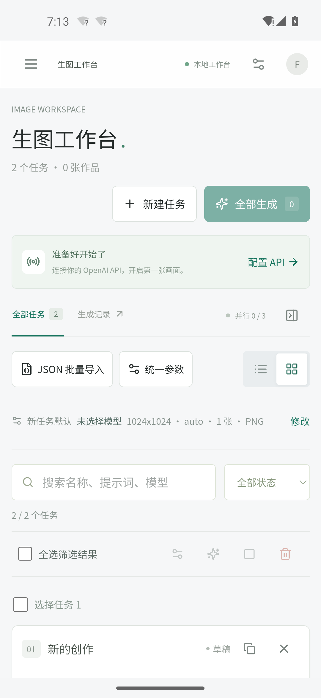

# FRAME · 图像工作台

中文批量生图工作台，提供电脑本地网页版和独立 Android APK。
通过 OpenAI Images API 兼容接口生成、编辑图片，支持自定义 API 地址与密钥、
真实模型同步、JSON 批量导入、独立任务参数和最多 100 个并行任务。

## 下载

- [正式发布与 Android APK](https://github.com/Zou82/frame-image-workbench/releases/latest)
- 电脑网页版：下载发布页的 `FRAME-Web-1.0.0.zip`，解压后双击 `start.cmd`。
- 安卓版：下载 `FRAME-1.0.0.apk` 并在手机安装，无需运行电脑服务。
- [Android 安装、兼容性和构建说明](docs/android.md)
- [模拟器验收记录](docs/android-testing.md)

这是自带 API 的本地工具，不含免费模型或内置调用密钥。
网页版需要本地 Node.js 服务，不能仅上传静态文件到 GitHub Pages 后直接使用。



## 打开

双击 `start.cmd`，程序会启动本地服务并打开浏览器。默认地址为
`http://127.0.0.1:4311`；端口被占用时自动选择 4312–4331。
关闭浏览器不会停止任务。双击 `stop.cmd` 可停止本地服务。

本机需要 Node.js 22.12+，推荐 Node.js 24 LTS。首次启动需要联网安装依赖；
本目录已经安装依赖时会直接构建并打开。

## 开始生成

1. 打开左侧「API 连接」，填写 API 地址和 API Key，保存配置。
2. 可以点击「测试连接」检查密钥，或「获取模型」同步当前连接返回的模型列表。
3. 在任务窗口填写提示词，选择模型、比例、画质和数量。需要参考图时可多选或拖入图片。
4. 点击单个任务的「生成图片」，或顶部「全部生成」。
5. 图片保存在任务面板和「作品与历史」中，点击图片可预览、下载或用作新任务参考图。

每个窗口的模型、API 连接、参考图、提示词与参数独立。支持新增/复制任务窗口、
每次生成 1–10 张图片，以及最多 100 个并行任务（新安装默认 3 个）；超出并发数的任务自动排队。
升级保留已有并发设置，可在「工作台设置」中用滑块或数字输入调整。

## 批量创作

1. 打开「统一参数」，选择共同模型、尺寸、画质等，点击「保存为新任务默认值」。
2. 打开「JSON 批量导入」，粘贴 JSON 或选择本地 JSON 文件。用 `defaults`
   填写统一参数，`tasks` 中每项写独立提示词；单个任务可覆盖任意共同参数。
3. 导入前会校验全部任务并显示预览。任一任务有错误时整批不导入，
   错误中 `tasks[0]` 表示第一个任务。导入仅创建草稿，点击「全部生成」才开始调用 API。
4. 大量任务用紧凑列表展示，每页 25 项；卡片每页 6 项。支持搜索、状态筛选、
   跨页全选、多选生成、取消和移除。点击任务名称或设置图标打开独立编辑器。
5. 批量修改时，只覆盖勾选的参数。可应用到所选或全部可编辑任务；
   其余参数、独立提示词和参考图保留。排队、生成、上传或提交中的任务自动跳过。

支持最多 500 个工作台任务、单次导入 500 项、实际同时生成最多 100 个任务。
任务总数与并发数分别设置，导入 100 个任务不会自动提高当前并发数。
参数优先级为：单任务覆盖 > JSON defaults > 工作台新任务默认值。
模型必须来自对应连接当前保存的实际模型列表，显式填写不存在的模型会报错。
JSON 不包含参考图文件；需要参考图时导入后在对应任务中添加。

可直接使用 `docs/batch-example.json` 和 `docs/ai-json-prompt.txt`。
导入窗口也可下载示例或复制提示词；窗口中的提示词会自动带入当前连接的真实模型 ID。
通用示例省略 model/profileId，沿用当前工作台默认值。

## 模型与参数

- 新连接的模型列表为空，不预填模型。「获取模型」使用当前连接返回的模型 ID
  替换原列表并立即保存，同时更新工作台；不会追加预置模型或保留已移除的旧模型。
  获取失败时保留上次成功的列表，成功返回空列表时清空该连接的模型。
- 未开始的任务若选择了已移除的模型，会改选该连接的第一个模型；
  正在生成的任务保持原请求。没有可用模型时不能提交生成。
- 模型列表不按名称过滤，以兼容中转站的自定义别名；接口列出模型不代表
  它一定支持 Images API，实际图像调用能力以服务商为准。
- 模型列表每行一个 ID，可添加账户中可用的其他 Images API 兼容模型。
  DALL·E 等不同参数协议的旧模型未做专门适配。
- 支持 `auto`、1024×1024、1536×1024、1024×1536，以及新模型的自定义尺寸。
- 新模型自定义尺寸：宽高须为 16 的倍数，最长边 ≤3840，宽高比 ≤3:1，
  总像素为 655360–8294400。GPT Image 1 系列只支持上述预设尺寸。
- 输出支持 PNG/JPEG/WebP。透明背景需使用支持透明的模型以及 PNG 或 WebP；
  GPT Image 2 系列不提供透明背景选项。
- 高级设置可填写 JSON 参数，例如 `{"output_compression": 85}` 或旧模型支持的
  `{"input_fidelity": "high"}`。模型、提示词、尺寸等基础字段请在面板中设置。
  额外参数是否可用，以所选模型和实际接口返回为准。
- 参考图支持 PNG/JPEG/WebP，最多 16 张，单张 ≤20 MB、≤5000 万像素。
  无参考图调用 `/images/generations`，有参考图调用 `/images/edits`。
- 可配置多个接口地址、密钥、模型列表和 30–1800 秒请求超时。
- API 地址只填写域名时会自动补上 `/v1`，例如 `https://wjapi.vip/` 会使用
  `https://wjapi.vip/v1`；已填写的 `/v1` 或其他自定义路径会保留。
  「测试连接」和「获取模型」会显示实际请求地址；失败时显示上游 HTTP 状态和错误码。
  如果网关返回 `401 / INVALID_API_KEY`，说明其模型列表接口未接受当前密钥，
  请在该服务的 API 密钥页面核对调用密钥及其权限，勿填写登录密码或网页登录令牌。
  将网址误填为 API Key 时，程序会在本地提示并阻止提交，不会向上游发起生成。

## 本地数据

所有数据位于 `data/`，不会出现在静态网页目录中：

| 路径 | 内容 |
| --- | --- |
| `data/settings.json` | API 配置与密钥 |
| `data/jobs.json` | 任务与历史记录 |
| `data/uploads/` | 上传的参考图片 |
| `data/outputs/` | 生成结果的原始图片 |
| `data/server.log`、`data/server-error.log` | 服务启动日志 |

API Key 以明文保存在本机 `data/settings.json`，不会返回浏览器，也不会写入
浏览器的草稿存储。请勿将 `data/` 一起发送给他人。
编辑密钥时留空会保留已保存的密钥；勾选「移除已保存的密钥」后保存可清除。

草稿保存在当前浏览器的本地存储中；重启服务后历史记录仍在。
重启时未完成任务会标为「已中断」，需要手动复用并重新提交，不会自动重试。
取消会中止本机等待和 HTTP 请求，不能保证上游已经开始的生成停止或免除计费。
移除历史只移除记录，图片文件保留，避免影响已作为参考图使用的结果。

## 开发与验证

```powershell
npm ci
npm test
npm run check
npm run build
npm start
```

`npm run dev` 启动 Vite（5173），需另开一个终端执行 `npm start`；
正式使用请用 `start.cmd`，前后端使用同一个本地地址。

测试使用本地模拟上游验证图片生成/多图编辑/图片落盘、密钥隐藏、并发、取消、
失败恢复、重启中断和参数校验，不调用付费生成服务。

## 文档与图片

官方接口参考：

- https://developers.openai.com/api/docs/guides/image-generation
- https://developers.openai.com/api/reference/resources/images/methods/generate
- https://developers.openai.com/api/reference/resources/images/methods/edit

灵感栏中的摄影参考来自 Unsplash，仅作为提示词灵感展示，并非程序生成结果：

- https://images.unsplash.com/photo-1608571423902-eed4a5ad8108
- https://images.unsplash.com/photo-1497250681960-ef046c08a56e
- https://images.unsplash.com/photo-1511818966892-d7d671e672a2
